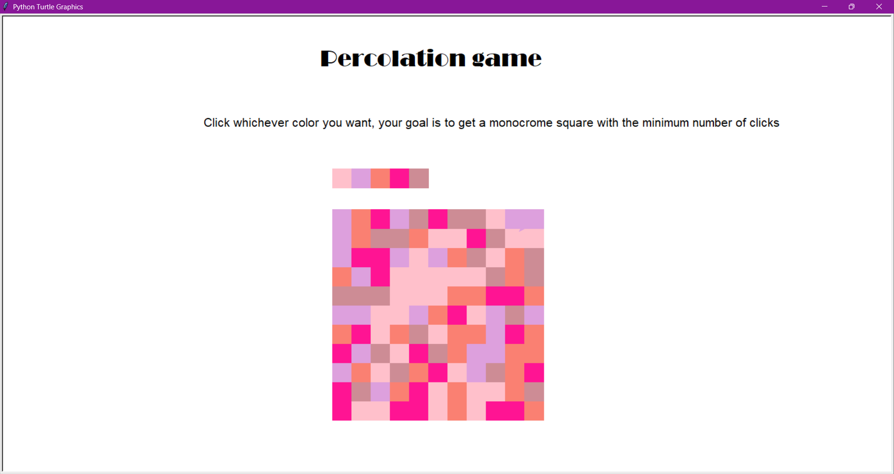
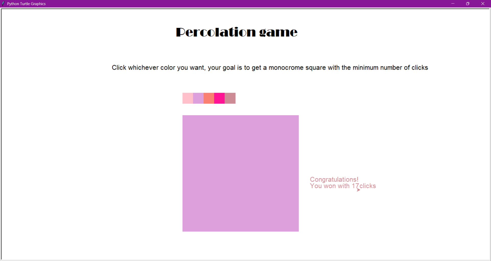

# Percolation Game

A small interactive python game, which uses the turtle module for graphics. The idea is similar to the flood style games, in which the final goal is to have a monochromatic square, with the least amount of clicks possible.





## Instructions

1. Click on a color in the  color palette above the square. The group of squares connected to the corner square will take the selected color.
2. Keep clicking until the entire board has been reduced to only one color.
3. When there is only one color left, you won! Be strategic, the smaller the number of clicks at the end, the better!

The region you control is the group of squares connected to the corner square `(0, 0)` that share its color. Each click recolors the whole region with the color you pick, and the region then absorbs every neighbouring square that already has that color.

## Requirements

- Python 3
- `turtle` (included with Python; on some Linux systems you may need to install Tk, e.g. `sudo apt install python3-tk`)

No other packages are needed.

## Running

```
percolatie.py
```

## How it works

- The board is stored as an `n x n` list of lists, `L`, holding a color index for each square.
- `Q` is the list of squares in the current region. `build_Q()` computes the starting region with a flood fill from the corner.
- On each click, `flood(color)` recolors every square in `Q`, then repeatedly scans the neighbours of region squares and adds those with the new color, until nothing more can be added.
- The game is won when the region covers the whole board.
- Drawing is done with turtle; `turtle.tracer(0)` is used while redrawing so the board appears at once.

## Settings

At the top of the script you can change:

- `n`: board size (`n x n` squares)
- `a`: side length of one square in pixels
- `Lcol`: the list of colors used

## Author

Nicole-Klarisza Demjen
